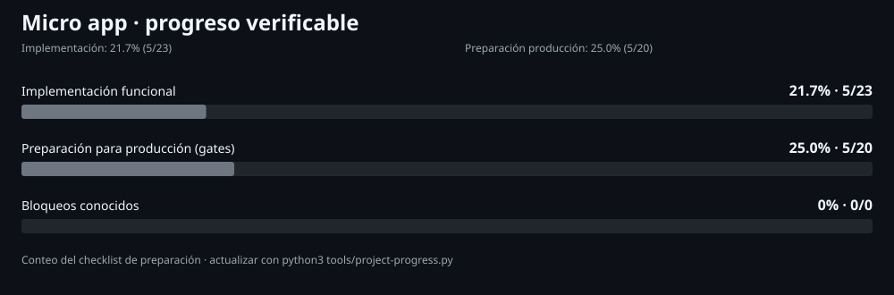

# Micro-app

## Estado del proyecto

- [Panel completo de avance y bloqueos](docs/progress/index.html)
- [Checklist con evidencia y criterios de salida](docs/PRODUCTION_READINESS.md)
- [Datos del panel en JSON](docs/progress/progress.json)

Las gráficas separan implementación funcional de preparación para producción. Los porcentajes cuentan criterios explícitos con evidencia; no son una estimación subjetiva ni certifican que el sistema esté listo. El panel se genera con `python3 tools/project-progress.py`.

## Desarrollo asistido por IA

- [Flujo Spec-Driven Development (SDD)](docs/SDD_WORKFLOW.md)
- [Modelo operativo de agentes](docs/AGENT_OPERATING_MODEL.md)
- [Plantillas de especificación, plan y tareas](templates/sdd/)
- [Skill reutilizable para funciones](skills/feature-sdd/SKILL.md)
- [Reglas principales para agentes](AGENTS.md)

Sistema web de punto de venta e inventario, diseñado para PC y móvil.

## Objetivo

Gestionar productos, códigos de barras, existencias, compras, ventas, pagos, caja, devoluciones y reportes con una interfaz rápida y accesible.

## Reglas fundamentales

- **Proyecto independiente:** no compartir código, base de datos, secretos ni despliegues con `Cantina-pos` u otros proyectos.
- **Moneda base:** USD. Los equivalentes en VES se calculan usando una tasa BCV validada y registrada.
- **Integridad:** PostgreSQL es la fuente de verdad para ventas e inventario; las operaciones críticas deben ser transaccionales e idempotentes.
- **Trazabilidad:** guardar movimientos de inventario, usuario responsable, auditoría y una instantánea de precios y tasa aplicada a cada venta.
- **Tasa:** guardar fuente, fecha efectiva, hora de consulta y estado; si falla la actualización, conservar la última tasa válida y advertir que está desactualizada.
- **Calidad:** no marcar funcionalidades como terminadas hasta que estén implementadas y verificadas con pruebas.

## Stack elegido para mantener el costo en $0

- **Frontend:** React + Vite + TypeScript; archivos estáticos servidos por Cloudflare Pages.
- **API:** Cloudflare Workers + Hono + TypeScript, en un servicio separado del frontend.
- **Base de datos:** PostgreSQL independiente en Neon Free, con Drizzle ORM y migraciones versionadas.
- **Pruebas:** Vitest y Playwright; automatización de CI con GitHub Actions dentro de las cuotas gratuitas.
- **Diseño:** CSS propio y dependencias open source; sin componentes premium.
- **Dominio:** usar el subdominio gratuito del proveedor al principio; un dominio personalizado normalmente cuesta dinero.

La arquitectura evita depender de funciones propietarias de un único hosting: React/Vite se puede servir en otros hostings estáticos, la API usa estándares web y PostgreSQL es portable. Los planes gratuitos tienen límites y pueden cambiar; no se promete capacidad ilimitada ni disponibilidad comercial garantizada. No se habilitará facturación automática ni se añadirá un servicio de pago para sortear límites.

No se usará Vercel Hobby como alojamiento objetivo de la operación: sus términos reservan ese plan al uso personal/no comercial. Si el uso de Micro app llega a requerir recursos de pago, se priorizará reducir/optimizar el uso o migrar a infraestructura gratuita que el usuario pueda operar, nunca generar cargos sin autorización.

## Plan de trabajo

1. Fundamentos del repositorio, documentación, controles de seguridad y CI.
2. Base de datos PostgreSQL independiente, migraciones y autenticación/roles.
3. Catálogo, códigos de barras, movimientos de inventario, proveedores y tasa BCV.
4. Caja/POS: carrito, descuentos autorizados, pagos, cambio, recibos, devoluciones y cierre de caja.
5. Interfaz responsive, temas automático/claro/oscuro y reportes.
6. Pruebas unitarias, integración y E2E en escritorio/móvil; despliegue de preview independiente.

## Criterios de aceptación

- Las ventas repetidas por reintento no se duplican.
- El stock no puede venderse por debajo de cero por concurrencia.
- Cada venta conserva precios y tasa usados en el momento de la operación.
- La tasa desactualizada se identifica claramente y nunca reemplaza una tasa válida con datos inválidos.
- Los permisos se validan en el servidor.
- Migraciones, pruebas y CI pasan antes de considerar una fase completada.

## Estado

- [x] Repositorio privado independiente creado.
- [x] Alcance y reglas iniciales documentados.
- [ ] Diseño visual final seleccionado.
- [x] Decisión inicial de arquitectura gratuita documentada.
- [x] Esqueleto inicial de frontend React/Vite y API Hono/Workers.
- [x] CI inicial: compilación, revisión de tipos y prueba de pantalla pasan en GitHub Actions.
- [x] Proyecto PostgreSQL independiente `micro-app-db` creado en la organización Neon propia de Micro app.
- [x] Esquema SQL inicial versionado y probado en una rama temporal aislada; su aplicación a la rama principal queda pendiente de revisión y autorización.
- [ ] Conexión de API a Neon y ejecución automatizada de migraciones.
- [ ] Migraciones, autenticación, funciones de negocio y preview desplegados.

El estado se actualizará a partir de trabajo verificable, no de estimaciones optimistas.

## Continuidad para agentes y nuevos chats

Antes de continuar trabajo, lee [`AGENTS.md`](AGENTS.md) y el [handoff vigente](docs/HANDOFF_NEXT_CHAT.md). La documentación de continuidad, decisiones, herramientas evaluadas y límites de seguridad está centralizada aquí:

- [Constitución del proyecto (reglas rectoras)](docs/CONSTITUTION.md)
- [Protocolo de continuidad IA/chat](docs/AI_CONTINUITY_PROTOCOL.md)
- [Plan maestro](docs/PROJECT_PLAN.md)
- [Diario de estado y verificaciones](docs/STATE_JOURNAL.md)
- [Registro de herramientas y fuentes](docs/RESOURCE_REGISTRY.md)
- [Evaluación de Gentleman-Programming](docs/GENTLEMAN_PROGRAMMING_EVALUATION.md)
- [Modelo operativo de agentes](docs/AGENT_OPERATING_MODEL.md)

Los perfiles en `.github/agents/` son instrucciones reutilizables; no implican que agentes autónomos estén activos. Los estados y pruebas deben verificarse contra el SHA actual de GitHub.

## Gentleman-Programming: implementación

El estado de adopción, configuración local de GGA, instrucciones de Engram y pasos de verificación están en [`docs/GENTLEMAN_IMPLEMENTATION.md`](docs/GENTLEMAN_IMPLEMENTATION.md). El archivo raíz `.gga` está preparado para revisión local con Ollama, pero no activa un hook ni afirma que GGA/Engram/Gentle-AI estén instalados.

## Seguridad y pruebas E2E

- [Checklist de seguridad OWASP ASVS](docs/OWASP_ASVS_CHECKLIST.md): controles pendientes con evidencia requerida.
- [Matriz de requisitos POS](docs/POS_REFERENCE_MATRIX.md): convierte la investigación de OSPOS, NexoPOS, Lakasir y POSNext en criterios de aceptación.
- [Playwright E2E](apps/web/playwright.config.ts): pruebas de navegador para login y errores de registro; el workflow de CI usa Chromium y datos simulados, sin servicios ni datos de producción.
- [Semgrep SAST](.github/workflows/semgrep.yml): análisis estático JS/TS con reporte SARIF como artefacto.
- [Trivy](.github/workflows/security-scan.yml): escaneo de filesystem/configuración/secretos existente, todavía no bloqueante.

La integración Playwright es un piloto de CI: su runner se instala temporalmente en el job para no alterar el lockfile en este cambio. Para reproducibilidad local completa, el siguiente paso es incorporar la versión de Playwright al workspace y regenerar pnpm-lock.yaml con pnpm 10 en un entorno ejecutable.